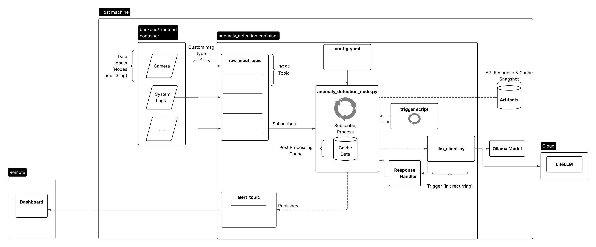
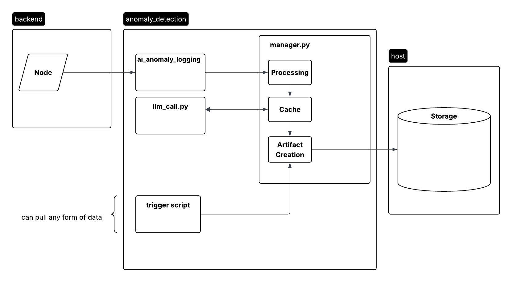

# AI Anomaly Detection
Last updated: 4/28/2026 

Anomaly Detection for a ROS2 system. Integrates with LiteLLM (https://docs.litellm.ai/docs/) or local Ollama model for determinations. 

1. Subscribes to `config.yaml:raw_input_topic` containing AnomalyMsg types.
2. Blocks duplicate messages with `config.yaml:duplicate_message_min_period_sec`, and converts AnomalyMsgs into compact string format for LLM.
3. Periodic/on-demand LLM trigger (`config.yaml:trigger_scripts` via ROS node publishing to `config.yaml:trigger_input_topic`).
4. LLM call using `llm_client.py`; a JSON artifact capturing the cached input data and model response is saved to `config.yaml:api_artifact_output_dir` on each invocation.
5. LLM response standardization into `Decision` type using `response_handler.py`.
6. Decision evaluation and alert publishing to `config.yaml:alert_topic`.
7. `.bag` file of entire run context monitoring `config.yaml:raw_input_topic` if enabled in separate terminal.

## Prerequisites

_It is recommended that this system exists in a Docker container that shares a network with (or contains) the source of ROS2 topics publishing system data. See (https://github.com/JACart2/docker_files/blob/main/services/anomaly_detection/Dockerfile)_

* ROS2 installed
* Requirements.txt. See (https://github.com/JACart2/docker_files/blob/main/services/anomaly_detection/requirements.txt)
* `.env` for local testing/prod run. Contains the API key associated with the model specified in `config.yaml`
* Python (>= 3.12 recommended, older versions may cause bugs)

Follow these steps below for Ollama config on host machine for supporting local model integration (assuming Linux OS)

1. curl -fsSL https://ollama.com/install.sh | sh
2. ollama pull `my_model`

_Assert that the downloaded model name matches with the names referenced in the AAD node's config.yaml._


## Project Structure

### ./anomaly_msg
The declaration of the custom message type that the anomaly detection system expects. Any data source that provides context to the anomaly detection service should send information using this message type to the topic specified in `config.yaml:raw_input_topic`.

### ./tester
Provides utility nodes such as: `fake_camera_data` and `lidar_test_node`. Both publish fake data and may be used to test dataflow in the system without external node access. Run with `ros2 run tester <NODE>`.

### ./system_evaluation/scripts
Standalone utility scripts that operate outside the ROS2 graph (not built/installed as part of any package).

`extract_anomaly_bag.py` reads a recorded `.mcap` bag of `AnomalyMsg` records and writes a self-contained report: `messages.json`, `messages.csv`, `summary.json`, extracted images under `images/`, and a searchable/filterable `index.html`. The HTML report also supports bag metadata, per-message labels, time-range labels, browser autosave, and JSON annotation import/export. It works locally without a server. Run with:
```
python3 system_evaluation/scripts/extract_anomaly_bag.py path/to/bag.mcap [-o output_dir]
```

The export button downloads `<bag-stem>.annotations.json`. Keep that sidecar beside
the source bag (or in another persistent dataset directory), not in the generated
report directory. For example:

```
system_evaluation/bags/driver_missing_001/
|-- driver_missing_001.mcap
|-- driver_missing_001.annotations.json
`-- report/
    |-- index.html
    |-- messages.json
    |-- messages.csv
    |-- summary.json
    `-- images/
```

The extractor recreates its output directory. As a safety measure, it refuses to
do so if it finds an `*.annotations.json` file there. The original MCAP is always
read-only. In-progress edits are keyed to the report path and bag name in browser
`localStorage`; JSON export remains the canonical dataset artifact.

Annotation files use `schema_version: 1`. Nanosecond timestamps are the primary
message identity, with topic and node name disambiguating them and message index
retained as useful provenance. The formal format is documented by
[`system_evaluation/schemas/anomaly_annotations.schema.json`](system_evaluation/schemas/anomaly_annotations.schema.json).

### ./anomaly_detection
The ROS2 node declaration for the anomaly detection system. 

`anomaly_detection_node.py` contains the manager that drives the system.

`config.yaml` contains system configuration such as API call frequency, cache size, LLM specs (prompt, local enabling, system_prompt), trigger script specification & trigger topic, input data topic for the AAD system, output alert topic for the AAD system, duplicate message blocking, logging frequency, and artifact output path & size.

`llm_client.py` integrates with the LLM either through an API call in LiteLLM, or through a locally hosted model through the Ollama CLI.

`response_handler.py` standardizes API responses into a `Decision` type.

### ./anomaly_detection/anomaly_detection/triggers
Each trigger script runs as its own ROS node and publishes to the `config.yaml:trigger_input_topic` topic. Adding a new trigger script requires:

**Required:**
- `trigger_scripts/<SCRIPT_NAME>/<SCRIPT_NAME>.py` — the ROS node
- `trigger_scripts/<SCRIPT_NAME>/install.sh`
- `config.yaml['trigger_scripts']` entry: `['<SCRIPT1_NAME>', '<SCRIPT2_NAME>']`

**Optional:**
- `trigger_scripts/<SCRIPT_NAME>/requirements.txt`

## Offline Testing

Use the [Offline Evaluator Instruction Manual](system_evaluation/OFFLINE_EVALUATOR_MANUAL.md)
for environment setup, recording annotations, experiment configuration, CLI
options, report interpretation, and troubleshooting.

From the ROS workspace root (normally `/root/dev_ws`), validate the configured
bags and experiments before running:

```bash
python3 src/anomaly_detection/system_evaluation/scripts/run_offline_evaluation.py \
  --config src/anomaly_detection/system_evaluation/offline_evaluation.yaml \
  --dry-run
```

Remove `--dry-run` to replay the bags and call the configured models. Dry runs
still require ROS and MCAP support to read bag metadata. Edit
[`offline_evaluation.yaml`](system_evaluation/offline_evaluation.yaml) to select
recordings, labeled or unlabeled evaluation, trials, and experiment overrides.
Human-labeled mode uses adjacent `<bag-stem>.annotations.json` sidecars exported
from the annotation report described above.

Results are written as timestamped Markdown and JSON reports under the configured
output directory (by default `system_evaluation/results/`). Check individual run
statuses and errors before comparing scores; unlabeled agreement is not
ground-truth accuracy.

## Artifact Generation

Each time the LLM is invoked, a JSON artifact is written to `config.yaml:api_artifact_output_dir` capturing a snapshot of the system state. 

Each artifact includes:
- **Artifact ID** — unique traceable identifier
- **Cached Data** — the log messages collected before the LLM call
- **API Response** — the structured decision returned by the LLM (anomaly flag, severity, action, summary)


## System Diagrams

### Architecture Diagram


### Dataflow Diagram


## Usage

Start the anomaly detection node:

```
ros2 run anomaly_detection anomaly_detection_node
```

For local inference, install Ollama and the configured model. For cloud
inference, select a provider profile and model in the AAD/evaluation YAML:

```yaml
llm:
  provider: anthropic
  model: claude-sonnet-4-5-20250929
  local: false
```

Offline evaluation reads endpoint and authentication setup from the separate
`runner.provider_config` file. `system_evaluation/llm_providers.yaml` contains
ready-to-use OpenAI and Anthropic profiles. Profiles reference environment
variable names rather than containing secrets:

```yaml
providers:
  anthropic:
    litellm_provider: anthropic
    api_key_env: ANTHROPIC_API_KEY
```

Export the referenced key before launching the evaluator:

```bash
export ANTHROPIC_API_KEY='...'
python3 system_evaluation/scripts/run_offline_evaluation.py \
  --config system_evaluation/offline_evaluation.yaml
```

Use `--provider-config PATH` to select a different profile file. Direct node
runs may instead set `AAD_LLM_PROVIDERS_PATH` or `llm.provider_config`.

See `config.yaml` for full deployment configuration options, including model selection, topic names, and trigger script registration.

## Attributions
Created by John Rosario Cruz (gr8jj28@gmail.com), Allie O'Keeffe, & Christopher Michael Hubbard.
